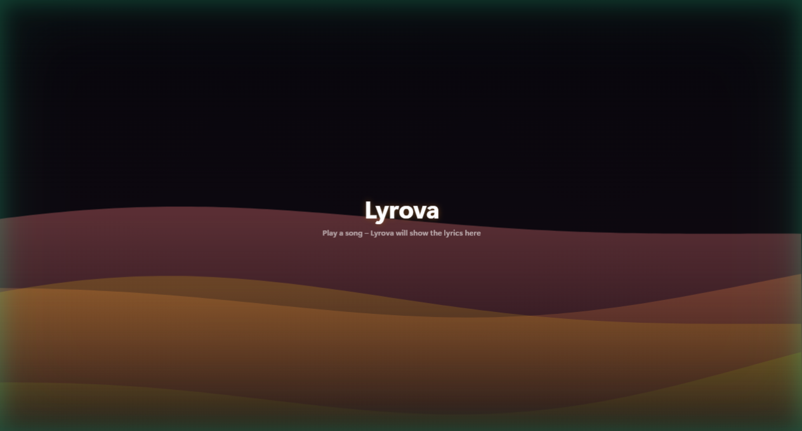
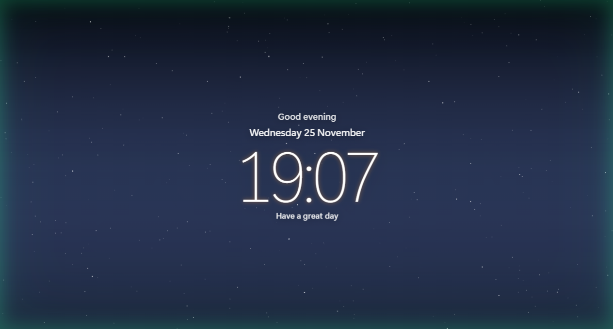

# Lyrova

**Time-synced lyrics as your animated Windows desktop wallpaper.**

Lyrova sits behind your desktop icons and shows the lyrics of whatever you're playing — Spotify,
YouTube in the browser, Apple Music, anything that shows up in the Windows media controls — line by
line, in time with the music. The active line glows and pulses with the bass of your system audio.

| Clock screen | Settings |
|---|---|
|  |  |

## Features

- **Real wallpaper** – runs behind the desktop icons (WorkerW technique via `koffi`, supports the
  classic Windows 10 desktop and the newer Windows 11 24H2+ layout). Falls back to a borderless
  fullscreen window if that isn't possible.
- **Multiple monitors** – choose per display: lyrics, a clock screen, background only, or off.
- **Automatic song detection** – title, artist, album, position and play/pause from the Windows
  media controls (SMTC). No login, no API keys.
- **Synced lyrics from [LRCLIB](https://lrclib.net)** – exact lookup by title/artist/album/duration
  with a search fallback, cleaned-up titles (no “(Official Video)” or “feat.” noise), local cache.
  Unsynced lyrics scroll gently; a subtle hint appears when nothing is found or you're offline.
- **Seven lyrics styles** – Column (active line big and glowing, neighbours dimmed and blurred),
  Scattered, Karaoke, One word, Pixel words, Typewriter and Neon. Font, size, colors and position
  are configurable.
- **Clock screen** – e.g. for a second display: seven clock styles (modern, glass, flip, analog,
  word clock, pixel, neon), date, greeting, your own text and a glass song card with the current
  lyrics line and its own background.
- **Bass-reactive effects** – glow, pulse, beat particles, a glowing screen edge and a subtle
  screen shake, each with its own strength slider (0 % = off), driven by your system audio
  (`getDisplayMedia` loopback + `AnalyserNode`). Nothing is recorded or sent anywhere.
- **Backgrounds** – animated color waves, particles or a starry sky, your own image or video, or
  the current album cover as a blurred backdrop.
- **Tray menu** – show/hide, pause/resume, settings, quit.
- **Settings window** – dark glass design in the logo colors, German UI (English included; translations live in one file
  per language).
- **Light on resources** – pauses while a fullscreen game, video or maximized window covers the
  screen, throttles on battery, configurable frame rate.
- **Start with Windows** (optional), single instance, automatic updates via GitHub Releases
  (can be turned off).

## Installation

1. Download `Lyrova-Setup.exe` from the [latest release](https://github.com/EinfachChef/lyrova/releases/latest).
2. Run it. No administrator rights are needed; you can pick the install folder.
3. Windows SmartScreen may warn because the app is not code-signed: click
   **More info → Run anyway**.

Lyrova starts right away. Double-click the tray icon (next to the clock) to open the settings.

**Uninstall:** Windows Settings → Apps → Installed apps → Lyrova → Uninstall.
Your settings stay in `%APPDATA%\Lyrova` unless you delete that folder.

## Development

Want to build Lyrova yourself or contribute? See [DEVELOPMENT.md](DEVELOPMENT.md).

## Privacy & copyright

Lyrova contains no lyrics. They are fetched at runtime from LRCLIB and only displayed on your own
screen. Song titles are sent to LRCLIB to look up the lyrics; nothing else leaves your PC. Lyrics
are copyrighted by their respective owners.

## License

[MIT](LICENSE) © 2026 Georg

The bundled font *Pixelify Sans* (used by the pixel styles) is licensed under the SIL Open Font
License 1.1 – see `src/renderer/fonts/PixelifySans-OFL.txt`.
